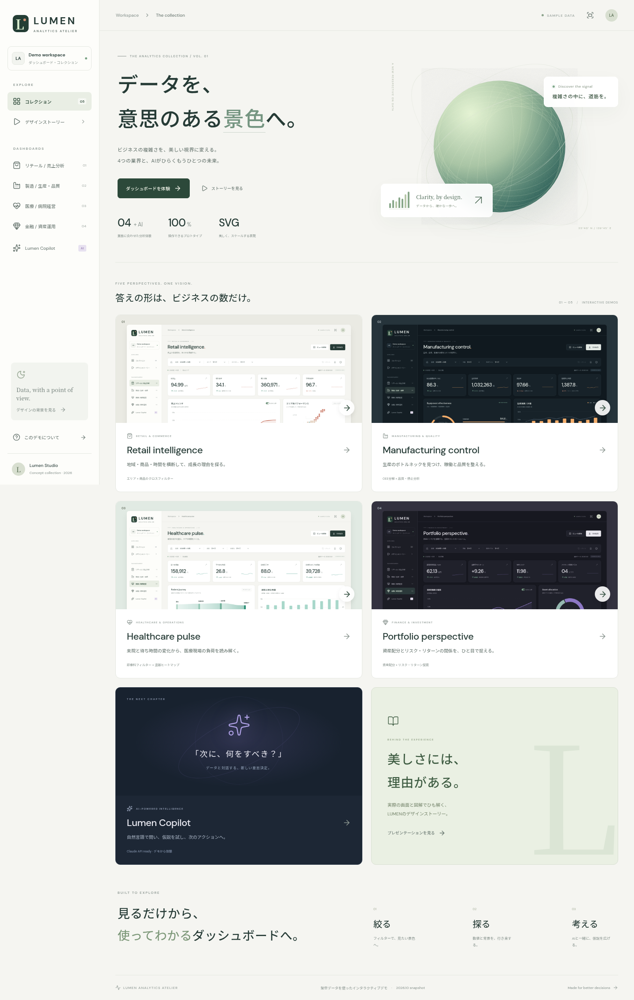

# LUMEN — Analytics Atelier

**データを、意思のある景色へ。**

[公開サイト](https://kentaro-oishi-c3creators.github.io/lumen-analytics/) · [紹介スライド](https://kentaro-oishi-c3creators.github.io/lumen-analytics/#/story) · [紹介資料PDF](https://kentaro-oishi-c3creators.github.io/lumen-analytics/lumen-design-story.pdf)

4業種のTableau風ダッシュボードと、Claude APIに接続できるAIコックピット。それらを紹介する10枚のインタラクティブなSVGスライドを収録した、React + TypeScript製のサンプルサイトです。

> すべて架空の合成データを使った独立したWebプロトタイプです。TableauのWorkbook（.twb/.twbx）やTableau製品の埋め込みではありません。データソースの接続・Tableau Serverへの発行は含みません。



## 収録内容

| 画面                  | 業界・用途     | 主な分析                                   | 見た目                            |
| --------------------- | -------------- | ------------------------------------------ | --------------------------------- |
| Retail intelligence   | 小売・EC       | 売上、粗利、地域、商品、予算               | アイボリー × テラコッタ           |
| Manufacturing control | 製造・品質     | OEE分解、生産計画、良品率、停止時間        | ディープネイビー × アンバー       |
| Healthcare pulse      | 医療・病院経営 | 来院、待ち時間、診療科負荷、患者フロー     | ミント × フォレスト               |
| Portfolio perspective | 金融・資産運用 | 月末残高、資産配分、市場、リスク・リターン | ナイトプラム × ラベンダー         |
| Lumen Copilot         | AI分析・経営   | 日本語での質問、データ要約、What-if        | ミッドナイト × ペールバイオレット |
| Designing decisions   | 紹介資料       | 実画面・操作例・業務図解・システム構成     | 10枚のSVG + PDF                   |

共通操作：期間・拠点・カテゴリーの連動フィルター、マークからの絞り込み、ツールチップ、明細ドリルダウン、並べ替え、CSV出力、ブラウザ内のビュー保存・復元、全画面、スマートフォン表示。

紹介スライド：左右矢印・Home・Endキー、自動再生、全画面、サムネイル移動、画面へのリンク、SVG/PDFダウンロード。業種一覧・操作例・最終スライドの図解カードはクリックできます。

## ローカル起動

Node.js 24以上を推奨します。

```bash
npm ci
npm run dev
```

表示されたURLをブラウザで開きます（通常は `http://localhost:5173/`）。デモでは外部APIもAPIキーも不要です。

```bash
npm test       # データ集計とAPIの検証
npm run build # TypeScriptチェック + 静的サイト生成
npm run preview
```

生成先は `dist/` です。ハッシュルーティングと相対アセットパスを使用するため、GitHub Pagesのリポジトリ配下でも動きます。

## GitHub Pagesで公開

対象アカウント：`kentaro-oishi-c3creators`。推奨リポジトリ名：`lumen-analytics`。

### 自動セットアップ

GitHub CLIで対象アカウントにログインした、GitHub APIへアクセスできる端末から実行します。APIトークンをコードやチャットに貼り付ける必要はありません。

```bash
bash scripts/publish-github.sh
```

アカウント照合 → 依存導入 → テスト → ビルド → 公開リポジトリの新規作成 → PagesのActions有効化 → push を行います。既存リポジトリがある場合は再利用します。既存履歴は強制上書きせず、リモートが一致しなければ停止します。

### 手動セットアップ

1. 新しい公開リポジトリを作成し、このソースを `main` にpushします。
2. リポジトリの **Settings → Pages → Build and deployment → Source** で **GitHub Actions** を選択します。
3. **Actions → Verify and publish GitHub Pages → Run workflow** を実行します（以後のmainへのpushは自動公開）。
4. 成功した `deploy` ジョブが返すURLを開きます。

公開URLは `https://kentaro-oishi-c3creators.github.io/lumen-analytics/` です。2026年11月1日にGitHub Pagesへのデプロイ成功を確認しました。以後のmainへのpushも自動公開されます。

Pages用ワークフローは `.github/workflows/pages.yml` に同梱しています。CIでは `npm ci`・8つのテスト・型チェック・Viteビルドを実行し、その成果物をPagesへ発行します。ClaudeのキーをGitHub Actionsに設定する必要はありません。

## Claude APIを接続

GitHub Pagesは静的ホスティングのため、Claudeを呼ぶAPIサーバーは別途実行します。ブラウザにAnthropicのキーを渡す実装はしていません。

```text
GitHub Pages (React)
    └─ HTTPS POST /api/chat + 接続トークン
         └─ Node.js API (server/)
              └─ AI SDK + Anthropic provider → Claude
```

1. `.env.example` を `.env` にコピーします（Gitには含めません）。
2. サーバーの環境変数を設定します。

| 変数                | 用途                                                                                                                       |
| ------------------- | -------------------------------------------------------------------------------------------------------------------------- |
| `ANTHROPIC_API_KEY` | AnthropicのAPIキー。サーバー専用                                                                                           |
| `CLAUDE_MODEL`      | ご自身のAnthropicアカウントで使えるモデルID。モデルを固定で推測しないため必須設定                                          |
| `API_ACCESS_TOKEN`  | APIサーバーへの接続を保護する長いランダム文字列                                                                            |
| `ALLOWED_ORIGIN`    | 許可するフロントエンドのOrigin。例：`https://kentaro-oishi-c3creators.github.io`。末尾スラッシュ・リポジトリパスを含めない |
| `PORT`              | APIのポート番号。初期値8787                                                                                                |

3. `npm run api` で起動します。サーバーを公開する場合はHTTPSで配置してください。
4. AI画面の **接続設定** にAPIの `https://.../api/chat` と `API_ACCESS_TOKEN` を設定します。Anthropicキーをこの画面に入力しないでください。

ローカルの場合は、ブラウザが `http://localhost:5173` なら `ALLOWED_ORIGIN=http://localhost:5173` とし、エンドポイントは `http://localhost:5173/api/chat`（Viteプロキシ経由）を設定できます。127.0.0.1を使う場合はOriginも一致させてください。

エンドポイントURLのみlocalStorageに保存します。接続トークンは画面のメモリ内だけで保持し、ページ更新で消去します。更新後はデモモードに戻ります。質問ごとに現在のエリア・集計値・月次データ・シナリオ前提を渡します。会話履歴はAPIに送らず、各質問を独立して扱います。フィルター変更後も過去の回答は当時の内容のままです。

APIにはOrigin照合、トークン認証、20KBの本文上限、1,000文字の質問上限、20回/時/IPの利用制限、30秒のタイムアウトがあります。認証エラーや上流エラーは画面に表示します。APIキーや上流例外は返しません。回数制限は単一プロセスのメモリ内の実装です。共有公開する本番AIサービスにする場合は、利用者認証と永続的な利用枠管理を追加してください。

**検証の範囲**：キー未提供のため実際のClaude呼び出しは未実施です。ローカルのデモ回答、ブラウザとAPIの接続、認証・制限・コンテキスト受け渡し・エラー表示は、モックの生成関数を使って確認しています。

## データと計算の前提

- 各業種160レコード：2026年1–10月 × 4拠点/市場 × 4区分。データ生成は決定的で再現可能です。
- Retail：金額は百万円。粗利益率 =（売上 − コスト）÷ 売上。
- Manufacturing：OEE = 時間稼働率 × 性能稼働率 × 良品率。予定時間は1レコードあたり160時間。性能は実績/計画（上限100%）。品質ロスの要因配分は説明用モデル。
- Healthcare：待ち時間は来院数で加重平均。完了率は完了数/来院数。患者フローの中間経路は説明用比率で、臨床実績ではありません。
- Finance：残高は選択期間の最終月。リターン・リスクは残高による加重平均。相関を考慮するポートフォリオリスクや実現リターンではありません。
- AI：12月ベースライン = 10月売上 × 1.05。シナリオ = ベースライン × (1 + 需要変化) × (1 + 単価変化)。想定粗利益 = シナリオ売上 × 過去の粗利益率 − 販促費。11月は10–12月の55%地点。帯は11月±6%・12月±9%の説明用範囲で、統計的信頼区間ではありません。価格弾力性や因果効果は含みません。

## 画面撮影・SVGの再生成

初期成果物は生成済みです。通常のビルドやPages公開にブラウザやPythonは不要です。

```bash
# 開発サーバーを起動した状態で実行
CHROMIUM_PATH=/usr/bin/chromium npm run screenshots
npm run slides
node scripts/presentation-qa.mjs
```

- 撮影：Playwright + Chromiumで実際のフィルター・保存・明細・CSV・AIデモを操作。画像は `public/captures/`。
- SVG生成：Node.jsとPython fontTools（`pyftsubset`）、Noto Sans CJKのシステムフォントを使用。`scripts/slides.mjs` に環境依存パスを記載。SVGはフォントと実画面画像を内包します。
- 資料：`public/slides/*.svg`、`public/lumen-design-story.pdf`、`public/lumen-svg-slides.zip`。
- 検証記録：`docs/browser-verification.json`、`docs/presentation-verification.json`、`docs/verification.md`。

## 構成

```text
src/
  App.tsx            ナビゲーション・コレクション
  Dashboard.tsx      4業種の分析画面
  AiDashboard.tsx    What-if・質問・接続設定
  Story.tsx          インタラクティブスライド
  data.ts            合成データ・集計・CSV
  components/UI.tsx  共通UI・ダイアログ・ツールチップ
server/              Claude用Node.js API
scripts/             撮影・資料生成・公開・接続検証
public/              生成済み画像・スライド・PDF
.github/workflows/   Pages自動公開
```

フォントは自己ホストし、外部CDNに依存しません。React・Recharts・Lucide・AI SDK等のライセンスは `THIRD_PARTY_NOTICES.md` を参照してください。
